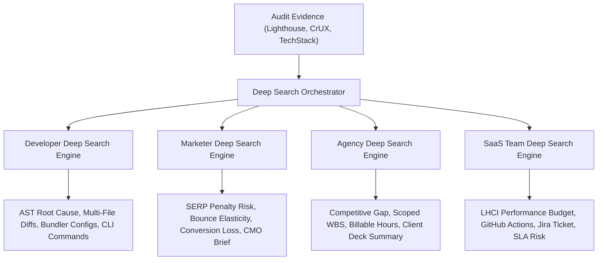

# SpeedPilot — Multi-Persona AI Deep Search Engine Specification

**Document Version:** 1.0.0  
**Package:** `@speedpilot/ai-engine/deep-search`  
**Status:** Implemented & Verified  

---

## 1. Executive Overview

Standard LLM audit outputs provide superficial single-turn explanations. SpeedPilot's **Multi-Persona AI Deep Search Engine** introduces specialized, multi-perspective diagnostic and analytical intelligence tailored to four key stakeholders:

1. **Developers (`DEVS`)**: Deep AST/bundler root cause analysis, framework-native code patches, configuration diffs, and terminal verification recipes.
2. **Marketers (`MARKETERS`)**: SEO rank risk correlation, bounce rate elasticity, organic traffic recovery projections, and conversion loss modeling.
3. **Agencies (`AGENCY`)**: Client-facing pitch talking points, competitive benchmark comparisons, scoped Work Breakdown Structure (WBS) with estimated billable hours, and milestone score gains.
4. **SaaS Platforms (`SAAS_TEAM`)**: CI/CD performance budgets (`lighthouserc.json`), automated PR regression guardrails, Jira/Linear sprint ticket templates, and SLA risk mitigation.

---

## 2. Multi-Persona Deep Search Architecture

---

## 3. Persona Data Models & Schemas

### 3.1 Developer Engine (`DEVS`)
- **Root Cause & Asset Trace**: Pinpoints exact resource, parser blocking state, and rendering phase bottleneck.
- **Remediation Code Diff**: Framework-tailored before/after snippet (React, Next.js, WordPress, Shopify, Laravel).
- **Bundler / Config Patch**: Specific configuration for `next.config.mjs`, `vite.config.ts`, `webpack.config.js`, or server `.htaccess` / NGINX.
- **Terminal Reproduction**: CLI command to verify regression fix locally.

### 3.2 Marketer Engine (`MARKETERS`)
- **SERP Rank Risk Rating**: High / Medium / Low correlation with Google Search Page Experience signals.
- **Bounce Rate Elasticity**: Quantitative bounce probability shift based on mobile latency benchmarks.
- **Estimated Conversion Impact**: Percentage conversion gain potential upon remediation.
- **Executive Pitch**: Jargon-free narrative suitable for weekly marketing and executive updates.

### 3.3 Agency Engine (`AGENCY`)
- **Client Pitch Narrative**: Value-focused positioning to present to non-technical stakeholders.
- **Competitive Gap Analysis**: Vertical-specific benchmark comparing median client performance with industry leaders.
- **Work Breakdown Structure (WBS)**: Phased remediation tasks with estimated implementation hours.
- **Projected Score Lift**: Expected PageSpeed Insights score jump (e.g. `+18 to +25 points`).

### 3.4 SaaS Platform Engine (`SAAS_TEAM`)
- **Performance Budget Rules**: Specific metric thresholds for CI/CD gates (e.g. `LCP <= 2200ms`, `Total Blocking Time <= 150ms`).
- **CI/CD Integration Snippet**: Ready-to-commit `lighthouserc.json` or GitHub Actions workflow block.
- **Ready Sprint Ticket**: Formatted Markdown title, description, and testable acceptance criteria for Linear / Jira.
- **SLA Breach Risk**: Probability assessment of customer SLA degradation under high concurrent traffic.

---

## 4. Zero-Key Fallback & Offline Determinism

When running without an active LLM key (`OPENAI_API_KEY`, `GEMINI_API_KEY`, or `ANTHROPIC_API_KEY`) or in dry-run mode, each engine evaluates deterministic heuristics based on the issue code (`render-blocking-resources`, `largest-contentful-paint-element`, `unminified-css`, `modern-image-formats`, etc.) and the detected tech stack.
