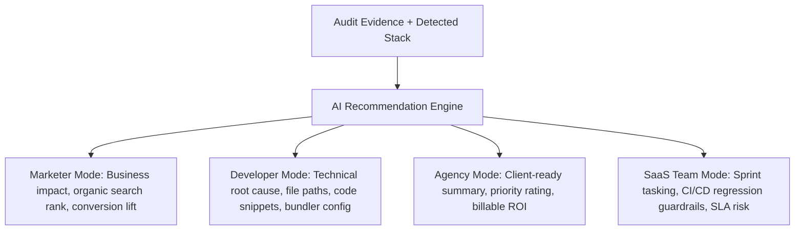

# SpeedPilot — AI Fix Assistant Architecture & Prompt Engineering

**Document Version:** 1.0.0  
**Package:** `@speedpilot/ai-engine`  

---

## 1. Engine Objective

The **AI Fix Assistant** is SpeedPilot's primary differentiator. Rather than confronting users with hundreds of intimidating Lighthouse diagnostic warnings or generic advice, the AI engine:
1. Distills raw technical diagnostics into compact, evidence-backed issue payloads.
2. Identifies the website's underlying technology framework.
3. Formulates multi-audience explanations (Marketer, Developer, Agency, SaaS Team).
4. Generates concrete code remediation examples (before and after) and step-by-step verification instructions.

---

## 2. Token Optimization & Context Compression

Raw Lighthouse JSON outputs often exceed 400KB to 1MB per audit execution. Piping this unstructured data directly into an LLM would:
- Deplete user API credits rapidly.
- Exceed token context limits.
- Induce LLM hallucination due to excessive diagnostic noise.

### 2.1 The Distillation Pipeline

```mermaid
flowchart LR
    LighthouseJSON["Raw Lighthouse JSON (500KB)"] --> Filter["Extract Failing Audits (Score < 0.9)"]
    Filter --> Extractor["Extract Key Opportunities & Diagnostics"]
    Extractor --> Normalizer["Normalize Evidence Items (URL, Bytes, WastedMs)"]
    Normalizer --> CompactPayload["Compact Audit Evidence JSON (< 4KB)"]
    CompactPayload --> PromptBuilder["Build Structured System & User Prompt"]
    PromptBuilder --> OpenAI["OpenAI API (gpt-4o-mini / gpt-4o)"]
    OpenAI --> StructuredOutput["Validated Zod Schema Output"]
```



### 2.2 Compact Evidence Schema
The AI engine transforms complex nested audits into a streamlined JSON payload:
```json
{
  "url": "https://example.com/checkout",
  "device": "mobile",
  "techStack": "SHOPIFY",
  "issue": {
    "auditId": "render-blocking-resources",
    "title": "Eliminate render-blocking resources",
    "displayValue": "Potential savings of 780 ms",
    "score": 0.42,
    "evidence": [
      {
        "url": "https://cdn.shopify.com/s/files/1/0001/t/2/assets/custom-theme.css",
        "wastedMs": 480,
        "totalBytes": 128400
      }
    ]
  }
}
```

---

## 3. Technology Stack Detection Heuristics

Before invoking the AI model, the `@speedpilot/seo-engine` inspects page metadata, HTTP headers, and DOM structures to tag the website's framework with deterministic evidence:

| Framework | Detection Heuristics |
| :--- | :--- |
| **WordPress** | Meta generator tag contains `WordPress`; assets reference `/wp-content/` or `/wp-includes/`; `wp-json` endpoint advertised. |
| **WooCommerce** | WordPress signatures present + DOM elements with class `.woocommerce`, script tag referencing `woocommerce.min.js`. |
| **Shopify** | Script tags referencing `cdn.shopify.com`; global `window.Shopify` object; cookies starting with `_shopify_`. |
| **Next.js** | Scripts matching `/_next/static/`; DOM element `<script id="__NEXT_DATA__">`; headers containing `x-powered-by: Next.js`. |
| **React** | Root DOM element `<div id="root">` with attribute `data-reactroot`; chunk hashes typical of Webpack/Vite React builds. |
| **Laravel** | Cookies named `laravel_session` or `XSRF-TOKEN`; input `_token` in forms; default Livewire or Inertia assets. |
| **Custom / Unknown** | Default fallback when no definitive framework signatures are detected. |

---

## 4. Multi-Audience Explanation Generation

A single audit failure requires distinct framing depending on the team member reviewing the dashboard:



### Structured Output Schema (Enforced via OpenAI Structured Outputs)
The AI engine validates responses using Zod:
```typescript
export const AIRecommendationSchema = z.object({
  detectedStack: z.enum([
    "WORDPRESS", "WOOCOMMERCE", "SHOPIFY", "NEXTJS", "REACT", "LARAVEL", "CUSTOM", "UNKNOWN"
  ]),
  explanationMarketer: z.string().describe("Plain English, business and conversion focused explanation without jargon."),
  explanationDeveloper: z.string().describe("Technical diagnosis detailing why the browser choked and exact code changes needed."),
  explanationAgency: z.string().describe("Concise client-facing talking points emphasizing competitive advantage and ROI."),
  explanationSaaSTeam: z.string().describe("Operational guidance focusing on SLA adherence and release regression risks."),
  remediationCodeSnippet: z.string().optional().describe("Accurate before-and-after code diff or configuration snippet."),
  implementationSteps: z.array(z.string()).min(2).max(5),
  verificationSteps: z.array(z.string()).min(1).max(3),
  estimatedDifficulty: z.enum(["EASY", "MEDIUM", "HARD"]),
  estimatedImpact: z.enum(["LOW", "MEDIUM", "HIGH"])
});
```

---

## 5. Caching, Cost Controls & Safety Rules

1. **Signature Caching:** An SHA-256 hash is computed from `auditCode + techStack + normalizedOffendingAsset`. If an identical issue (e.g. standard Google Analytics render-blocking pattern) has already been solved in the workspace, the cached recommendation is returned immediately without LLM invocation.
2. **AI Provider Abstraction:** While OpenAI (`gpt-4o-mini` for fast high-volume recommendations, `gpt-4o` for deep audits) is the default, the interface allows plugging in Google Gemini, Anthropic, or local Ollama models.
3. **Execution Safety Policy:** SpeedPilot strictly provides recommendations and code diffs. Under no circumstances does the application automatically execute or deploy AI code onto customer production servers.

