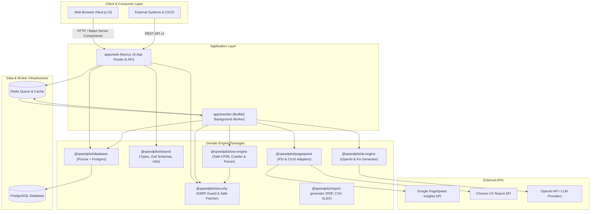
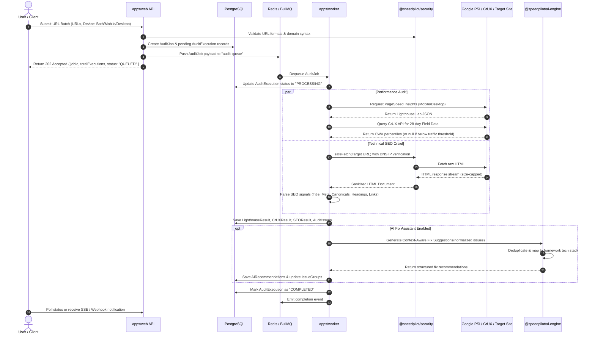

# SpeedPilot — System Architecture & Technical Design

**Document Version:** 1.0.0  
**Status:** Approved Architecture  

---

## 1. High-Level Architecture Overview

SpeedPilot is structured as a modular TypeScript monorepo designed for high throughput, strict security, and maintainable separation of concerns.

The platform separates synchronous user interactions (Next.js web application) from long-running, rate-limited asynchronous audit workloads (BullMQ background worker cluster) using a centralized Redis message broker and PostgreSQL database with Prisma ORM.



---

## 2. Monorepo Structure & Package Boundaries

```
speedpilot/
├── apps/
│   ├── web/                    # Next.js 15+ App Router, shadcn/ui, Recharts, API routes
│   └── worker/                 # Standalone Node.js BullMQ worker process for audit execution
├── packages/
│   ├── database/               # Prisma schema, migrations, generated client, repository abstractions
│   ├── shared/                 # Zod validation schemas, TypeScript interfaces, metric constants, formatters
│   ├── security/               # SSRF protection, DNS resolver validation, IP subnet filtering, safe-fetch
│   ├── pagespeed/              # Google PageSpeed Insights & Chrome UX Report API clients with rate limiters
│   ├── seo-engine/             # Independent HTTP crawler, DOM parser, Technical SEO hygiene evaluator
│   ├── ai-engine/              # Context builder, issue normalizer, OpenAI client, audience fix prompt engine
│   └── report-generator/       # High-fidelity PDF, Excel XLSX, and CSV data export engines
├── docs/                       # Architecture, PRD, Database, API, and Operations documentation
├── scripts/                    # Database seeds, migration runners, and local utility scripts
├── tests/                      # Monorepo-level integration and end-to-end test suites
├── docker-compose.yml          # Container orchestration for Postgres, Redis, Web, and Worker
├── package.json                # Root npm workspace manifest
└── README.md                   # Getting started and project overview
```

### Boundary Guarantees:
1. **Zero UI Imports in Core Engines:** Packages like `pagespeed`, `seo-engine`, `ai-engine`, and `security` never import React, Next.js, or browser packages. They are strictly portable, pure Node/TypeScript packages with 100% testable unit surfaces.
2. **Database Isolation:** Database queries occur exclusively through `@speedpilot/database`. Neither frontend components nor background jobs issue raw unvalidated SQL.
3. **SSRF Guarding:** Any outgoing HTTP request to user-submitted target URLs or XML sitemaps must pass through `@speedpilot/security`'s `safeFetch` client.

---

## 3. Data Processing & Audit Job Pipeline

When a user initiates an audit (single URL, batch, CSV, or sitemap), the system follows an asynchronous, resilient pipeline:



---

## 4. Key Architectural Decisions

### 4.1 Strict Separation of Lab vs. Field Data
- **Problem:** Many tools erroneously display Lighthouse Total Blocking Time (TBT) as Interaction to Next Paint (INP), or display 0ms when field data is absent.
- **Solution:** SpeedPilot models `LighthouseResult` and `CrUXResult` as separate relational tables. The UI visually segregates synthetic lab benchmarks from 28-day real-user field telemetry. If CrUX data is absent due to insufficient Chrome traffic, the UI clearly displays "No CrUX field data available for this URL" while checking and displaying domain origin-level data where possible.

### 4.2 SSRF Protection Architecture
- Any system that accepts arbitrary URLs for scraping or analysis is vulnerable to Server-Side Request Forgery attacks targeting cloud metadata (`169.254.169.254`), container interfaces, internal databases, or private subnets (`10.0.0.0/8`, `172.16.0.0/12`, `192.168.0.0/16`, `127.0.0.0/8`).
- **Enforcement:** The `@speedpilot/security` package implements custom DNS resolution hooks that verify every IP address before socket connection, checks redirect destinations iteratively, and enforces a hard payload limit (e.g., 5MB) and 10s request timeout.

### 4.3 AI Engine Token Optimization & Prompt Caching
- Raw Lighthouse output can exceed 400KB of JSON per page.
- SpeedPilot extracts only critical opportunities, failing audits, and technical SEO errors into a normalized, compact JSON evidence schema (< 5KB).
- Reusable audit patterns are keyed by signature hash to avoid redundant LLM invocations for identical third-party library issues across hundreds of project URLs.

