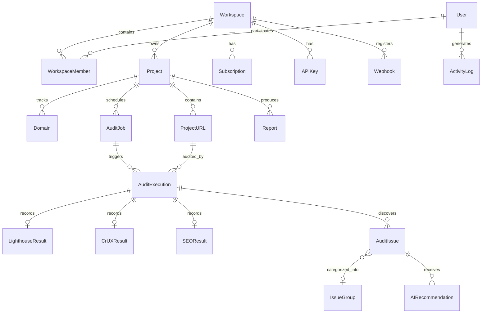

# SpeedPilot — Relational Database Schema & Data Modeling

**Document Version:** 1.0.0  
**Database Engine:** PostgreSQL 16+  
**ORM:** Prisma ORM  

---

## 1. Schema Design Principles

1. **UUID Primary Keys:** All entities use UUID v4 primary keys (`id String @id @default(uuid())`) to prevent ID enumeration vulnerabilities and simplify distributed multi-region operations.
2. **Workspace Isolation:** All project-related tables carry a `workspaceId` foreign key to ensure strict multi-tenant authorization barriers.
3. **Audit History Immutability:** An `AuditExecution` record represents an immutable snapshot in time. Rerunning an audit creates a new execution row rather than mutating historical benchmarks.
4. **Normalized Lab vs. Field Metric Storage:** Lighthouse metrics, CrUX field data, and Technical SEO checks are isolated in distinct sub-tables with foreign keys to `AuditExecution`.
5. **Safe Deletion Rules:** Cascade deletes are limited to parent-child ownership hierarchies (e.g. Deleting an `AuditExecution` cascades to its `LighthouseResult` and `CrUXResult`). Critical audit activity and billing transactions maintain audit trails.

---

## 2. Entity Relationship Overview

---

## 3. Core Entity Specifications

### 3.1 Authentication & Workspace Hierarchy

#### `User`
Stores authenticated user accounts.
- `id` (UUID, PK)
- `email` (String, unique, indexed)
- `name` (String, nullable)
- `passwordHash` (String, nullable for OAuth accounts)
- `avatarUrl` (String, nullable)
- `createdAt` (DateTime)
- `updatedAt` (DateTime)

#### `Workspace`
Multi-tenant organizational boundary for agencies, companies, and individuals.
- `id` (UUID, PK)
- `name` (String)
- `slug` (String, unique, indexed)
- `logoUrl` (String, nullable)
- `customDomain` (String, nullable, for agency white-label reports)
- `createdAt` (DateTime)
- `updatedAt` (DateTime)

#### `WorkspaceMember`
Role-based access mapping users to workspaces.
- `id` (UUID, PK)
- `workspaceId` (UUID, FK -> Workspace.id)
- `userId` (UUID, FK -> User.id)
- `role` (Enum: `OWNER`, `ADMIN`, `MEMBER`, `VIEWER`)
- `createdAt` (DateTime)
- Unique constraint: `[workspaceId, userId]`

#### `Plan` & `Subscription`
Configurable subscription tiers and billing tracking.
- `Plan`: `id`, `name`, `code` (`FREE`, `STARTER`, `PRO`, `AGENCY`), `maxAuditsPerMonth`, `maxConcurrentJobs`, `maxUrlsPerProject`, `hasWhiteLabel`, `hasAPI`, `hasScheduledAudits`
- `Subscription`: `id`, `workspaceId`, `planId`, `status` (`ACTIVE`, `PAST_DUE`, `CANCELED`), `currentPeriodStart`, `currentPeriodEnd`, `stripeCustomerId`, `stripeSubscriptionId`

---

### 3.2 Projects, Targets & Auditing Pipeline

#### `Project`
Top-level collection of URLs representing a website or client.
- `id` (UUID, PK)
- `workspaceId` (UUID, FK -> Workspace.id, indexed)
- `name` (String)
- `description` (Text, nullable)
- `primaryDomain` (String)
- `techStack` (Enum: `WORDPRESS`, `WOOCOMMERCE`, `SHOPIFY`, `NEXTJS`, `REACT`, `LARAVEL`, `CUSTOM`, `UNKNOWN`)
- `createdAt` (DateTime)
- `updatedAt` (DateTime)

#### `ProjectURL`
Target web pages monitored within a project.
- `id` (UUID, PK)
- `projectId` (UUID, FK -> Project.id, indexed)
- `url` (String, indexed)
- `normalizedUrl` (String, indexed)
- `label` (String, nullable)
- `isActive` (Boolean, default true)
- `createdAt` (DateTime)
- Unique constraint: `[projectId, normalizedUrl]`

#### `AuditJob`
A batch execution container coordinating multiple URL audits.
- `id` (UUID, PK)
- `projectId` (UUID, FK -> Project.id, indexed)
- `workspaceId` (UUID, FK -> Workspace.id, indexed)
- `source` (Enum: `MANUAL_SINGLE`, `TEXTAREA_BULK`, `CSV_IMPORT`, `SITEMAP_IMPORT`, `SCHEDULED_CRON`, `API_TRIGGER`)
- `deviceMode` (Enum: `MOBILE`, `DESKTOP`, `BOTH`)
- `status` (Enum: `PENDING`, `QUEUED`, `PROCESSING`, `COMPLETED`, `PARTIAL_FAILURE`, `FAILED`, `CANCELLED`)
- `totalUrls` (Integer)
- `completedUrls` (Integer, default 0)
- `failedUrls` (Integer, default 0)
- `errorMessage` (Text, nullable)
- `startedAt` (DateTime, nullable)
- `completedAt` (DateTime, nullable)
- `createdAt` (DateTime)

#### `AuditExecution`
Individual audit run for a specific URL and target device.
- `id` (UUID, PK)
- `auditJobId` (UUID, FK -> AuditJob.id, indexed)
- `projectUrlId` (UUID, FK -> ProjectURL.id, indexed)
- `url` (String)
- `device` (Enum: `MOBILE`, `DESKTOP`)
- `status` (Enum: `QUEUED`, `FETCHING`, `AUDITING`, `ANALYZING_AI`, `COMPLETED`, `FAILED`, `CANCELLED`)
- `retryCount` (Integer, default 0)
- `errorMessage` (Text, nullable)
- `executionTimeMs` (Integer, nullable)
- `createdAt` (DateTime)
- `completedAt` (DateTime, nullable)

---

### 3.3 Diagnostic & Metric Results

#### `LighthouseResult`
Parsed synthetic lab audit results from Google PageSpeed Insights.
- `id` (UUID, PK)
- `auditExecutionId` (UUID, unique, FK -> AuditExecution.id)
- `performanceScore` (Float: 0.0 to 100.0)
- `accessibilityScore` (Float: 0.0 to 100.0)
- `bestPracticesScore` (Float: 0.0 to 100.0)
- `seoScore` (Float: 0.0 to 100.0)
- `fcpMs` (Float, First Contentful Paint in milliseconds)
- `lcpMs` (Float, Largest Contentful Paint in milliseconds)
- `tbtMs` (Float, Total Blocking Time in milliseconds)
- `cls` (Float, Cumulative Layout Shift score)
- `speedIndexMs` (Float, Speed Index in milliseconds)
- `rawJsonStoragePath` (String, optional pointer to compressed raw JSON)
- `createdAt` (DateTime)

#### `CrUXResult`
Real-user field telemetry (Chrome UX Report 28-day rolling window).
- `id` (UUID, PK)
- `auditExecutionId` (UUID, unique, FK -> AuditExecution.id)
- `scope` (Enum: `URL`, `ORIGIN`, `UNAVAILABLE`)
- `lcpValueMs` (Float, nullable)
- `lcpCategory` (Enum: `GOOD`, `NEEDS_IMPROVEMENT`, `POOR`, nullable)
- `inpValueMs` (Float, nullable)
- `inpCategory` (Enum: `GOOD`, `NEEDS_IMPROVEMENT`, `POOR`, nullable)
- `clsValue` (Float, nullable)
- `clsCategory` (Enum: `GOOD`, `NEEDS_IMPROVEMENT`, `POOR`, nullable)
- `collectionPeriod` (String, nullable, e.g. "2026-10-01 to 2026-10-28")
- `createdAt` (DateTime)

#### `SEOResult`
Independent Technical SEO crawler results.
- `id` (UUID, PK)
- `auditExecutionId` (UUID, unique, FK -> AuditExecution.id)
- `httpStatus` (Integer)
- `isHttps` (Boolean)
- `pageTitle` (Text, nullable)
- `titleLength` (Integer, nullable)
- `metaDescription` (Text, nullable)
- `descriptionLength` (Integer, nullable)
- `canonicalUrl` (Text, nullable)
- `isCanonicalMatch` (Boolean)
- `robotsDirectives` (String, nullable, e.g. "index, follow")
- `h1Count` (Integer)
- `h1Text` (Text, nullable)
- `hasBrokenInternalLinks` (Boolean)
- `brokenLinksCount` (Integer, default 0)
- `missingAltImagesCount` (Integer, default 0)
- `hasOpenGraph` (Boolean)
- `hasStructuredData` (Boolean)
- `createdAt` (DateTime)

---

### 3.4 Findings, Intelligence & AI Fixes

#### `AuditIssue`
Discrete performance or SEO problem discovered during an execution.
- `id` (UUID, PK)
- `auditExecutionId` (UUID, FK -> AuditExecution.id, indexed)
- `issueGroupId` (UUID, nullable, FK -> IssueGroup.id, indexed)
- `code` (String, e.g. `render-blocking-resources`, `unused-javascript`, `missing-alt-tags`)
- `title` (String)
- `category` (Enum: `PERFORMANCE`, `ACCESSIBILITY`, `BEST_PRACTICES`, `SEO`, `TECHNICAL_SEO`)
- `severity` (Enum: `LOW`, `MEDIUM`, `HIGH`, `CRITICAL`)
- `displayValue` (String, nullable, e.g. "Potential savings of 1,240 ms")
- `evidenceDetails` (JSON, storing offending resource URLs, byte weights, or DOM selectors)
- `createdAt` (DateTime)

#### `IssueGroup`
Cross-page aggregated problem across URLs within a project.
- `id` (UUID, PK)
- `projectId` (UUID, FK -> Project.id, indexed)
- `code` (String, indexed)
- `title` (String)
- `severity` (Enum: `LOW`, `MEDIUM`, `HIGH`, `CRITICAL`)
- `sharedResource` (String, nullable, e.g. `https://cdn.example.com/legacy-bundle.js`)
- `affectedUrlCount` (Integer, default 1)
- `createdAt` (DateTime)
- `updatedAt` (DateTime)

#### `AIRecommendation`
Audience-tailored fix recommendation generated for an issue or issue group.
- `id` (UUID, PK)
- `auditIssueId` (UUID, nullable, FK -> AuditIssue.id, indexed)
- `issueGroupId` (UUID, nullable, FK -> IssueGroup.id, indexed)
- `detectedStack` (Enum: `WORDPRESS`, `WOOCOMMERCE`, `SHOPIFY`, `NEXTJS`, `REACT`, `LARAVEL`, `CUSTOM`, `UNKNOWN`)
- `explanationMarketer` (Text)
- `explanationDeveloper` (Text)
- `explanationAgency` (Text)
- `explanationSaaSTeam` (Text)
- `remediationCodeSnippet` (Text, nullable)
- `implementationSteps` (JSON, array of strings)
- `verificationSteps` (JSON, array of strings)
- `estimatedDifficulty` (Enum: `EASY`, `MEDIUM`, `HARD`)
- `estimatedImpact` (Enum: `LOW`, `MEDIUM`, `HIGH`)
- `promptTokens` (Integer)
- `completionTokens` (Integer)
- `signatureHash` (String, indexed, for deduplication & caching)
- `createdAt` (DateTime)

---

### 3.5 Automation, Monitoring & Integrations

#### `Schedule`
Automated recurring audit rules.
- `id` (UUID, PK)
- `projectId` (UUID, FK -> Project.id, indexed)
- `frequency` (Enum: `DAILY`, `WEEKLY`, `MONTHLY`, `CUSTOM_CRON`)
- `cronExpression` (String, nullable)
- `deviceMode` (Enum: `MOBILE`, `DESKTOP`, `BOTH`)
- `isActive` (Boolean, default true)
- `lastRunAt` (DateTime, nullable)
- `nextRunAt` (DateTime, nullable)

#### `APIKey`
Programmatic access credentials.
- `id` (UUID, PK)
- `workspaceId` (UUID, FK -> Workspace.id, indexed)
- `name` (String)
- `keyPrefix` (String, e.g. `sp_live_9a8f...`)
- `keyHash` (String, unique, SHA-256 hashed secret)
- `lastUsedAt` (DateTime, nullable)
- `expiresAt` (DateTime, nullable)
- `createdAt` (DateTime)

#### `Webhook`
Outbound event notification endpoints.
- `id` (UUID, PK)
- `workspaceId` (UUID, FK -> Workspace.id, indexed)
- `url` (String)
- `secret` (String, for HMAC-SHA256 signature verification)
- `events` (JSON, array of subscribed event types)
- `isActive` (Boolean, default true)
- `createdAt` (DateTime)
