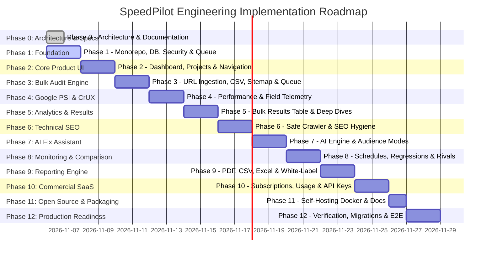

# SpeedPilot — Engineering Roadmap & Phase Execution Plan

**Document Version:** 1.0.0  
**Methodology:** Incremental, Phase-by-Phase Verified Delivery  

---

## 1. Roadmap Overview

---

## 2. Phase Breakdown & Deliverables

### Phase 0: Architecture & Planning (Deliverable: Complete Technical Blueprint)
- [x] Workspace inspection and environment audit.
- [x] Comprehensive PRD (`docs/PRD.md`).
- [x] Technical architecture & package boundaries (`docs/ARCHITECTURE.md`).
- [x] Relational database modeling (`docs/DATABASE.md`).
- [x] REST API v1 specification (`docs/API.md`).
- [x] Security model & SSRF mitigation architecture (`docs/SECURITY.md`).
- [x] AI Fix Assistant prompt engineering & token compression (`docs/AI-ENGINE.md`).
- [x] Job queue & rate limiting architecture (`docs/JOB-QUEUE.md`).
- [x] UI/UX design specifications (`docs/UI-UX.md`).
- [x] Deployment, licensing, and testing specifications.
- [x] `DEVELOPMENT-STATUS.md` tracker initialization.

### Phase 1: Core Foundation & Infrastructure
- Initialize root workspace (`package.json`, TypeScript, ESLint, Prettier).
- Create core packages: `@speedpilot/database`, `@speedpilot/shared`, `@speedpilot/security`.
- Implement Prisma schema with PostgreSQL models and migrations.
- Build SSRF-safe HTTP client (`safeFetch`) with DNS resolution and private CIDR blocking.
- Configure Redis connection and BullMQ queue initialization.
- Provide `docker-compose.yml` for local PostgreSQL and Redis orchestration.

### Phase 2: Product UI & Shell
- Initialize `apps/web` with Next.js 15 App Router and Tailwind CSS.
- Build design system tokens, typography, dark/light theme toggle, and icons.
- Build primary application navigation shell (Sidebar, Topbar, Workspace selector).
- Implement main Dashboard overview with key metric scorecards, recent activity, and true empty states.
- Implement Project Management screens (Create, Edit, List, Project Details).

### Phase 3: Bulk URL Audit Engine
- Implement multi-format URL ingestion: single URL, multi-line textarea, CSV parser, and XML sitemap discoverer.
- Implement URL normalization, deduplication, and syntax validation.
- Implement batch job creator and BullMQ queue producer.
- Implement `apps/worker` background runner with concurrency and error handlers.

### Phase 4: Google PSI & CrUX Integrations
- Implement `@speedpilot/pagespeed` with official Google PageSpeed Insights REST API client.
- Implement Chrome UX Report (CrUX) REST API client.
- Separate and normalize lab diagnostics (FCP, LCP, TBT, CLS) from field metrics (CrUX LCP, INP, CLS).
- Implement rate limiting (200 req/min) and exponential backoff on 429/503 errors.

### Phase 5: Results & Analytics Interface
- Implement high-performance Bulk Results Table with sorting, filtering, and search.
- Build Individual Audit Execution detail screen.
- Implement Core Web Vitals diagnostic gauges and historical trend charts.
- Build expandable rows for immediate opportunity inspection.

### Phase 6: Independent Technical SEO Intelligence
- Implement `@speedpilot/seo-engine` using safe static HTML streaming and DOM parsing (Cheerio).
- Implement checks: Page Title, Meta Description, Canonical URL, Robots rules, Heading structure (H1), Image alt tags, Internal broken links, and JSON-LD structured data.
- Integrate SEO findings into the Audit Execution results.

### Phase 7: AI Fix Assistant
- Implement `@speedpilot/ai-engine` with OpenAI integration and provider abstraction.
- Build audit evidence distillation pipeline (extracting < 5KB payloads from raw diagnostics).
- Implement technology framework detection (WordPress, WooCommerce, Shopify, Next.js, React, Laravel, Custom).
- Implement audience-aware outputs: Marketer, Developer, Agency, and SaaS Team modes.
- Implement recommendation signature caching and cost controls.

### Phase 8: Website Monitoring & Competitor Comparison
- Implement automated audit scheduling (Daily, Weekly, Monthly).
- Implement historical regression detection comparing runs against past baselines.
- Build Competitor Benchmarking screen comparing multiple target domains.

### Phase 9: Reports & Client Export
- Implement `@speedpilot/report-generator` for PDF, CSV, and Excel (XLSX) exports.
- Implement agency white-label report configuration (custom logo, colors, header/footer).

### Phase 10: Commercial SaaS Capabilities
- Implement Plan and Subscription entitlement layer.
- Implement usage metering (audits executed, AI tokens used).
- Implement API Key management and webhook outbound dispatchers.

### Phase 11: Open-Source Distribution & Self-Hosting
- Apache 2.0 license review and community documentation.
- Provide self-hosting Docker configuration and quickstart guide.
- GitHub Actions CI workflow for linting, type-checking, and tests.

### Phase 12: Production Readiness & Verification
- Comprehensive unit, integration, and end-to-end test execution.
- Performance and security verification.
- Release documentation and CHANGELOG.md.
