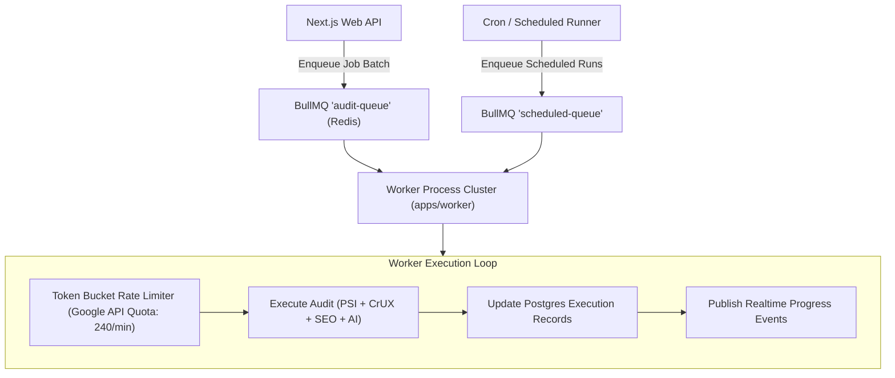

# SpeedPilot — Asynchronous Job Queue & Worker Architecture

**Document Version:** 1.0.0  
**Technology:** BullMQ 5+ with Redis 7+  

---

## 1. Queue Strategy & Architecture

SpeedPilot audits can involve batches of hundreds of URLs across mobile and desktop devices. The system utilizes BullMQ and Redis to manage this asynchronous workload with fine-grained rate limiting, job persistence, failure retries, and cancellation capabilities.



---

## 2. Queue Definitions & Payload Schemas

### 2.1 Queues

| Queue Name | Concurrency (Default) | Purpose |
| :--- | :--- | :--- |
| `audit-execution-queue` | 5 workers (configurable) | Individual URL audit executions (PSI lab, CrUX field, SEO crawl, AI fix). |
| `audit-batch-coordinator` | 2 workers | Orchestrates batch jobs, aggregates issue groups, and triggers completion notifications. |
| `report-generation-queue` | 2 workers | Asynchronously compiles and exports large PDF, CSV, and Excel reports. |

### 2.2 Job Payload Schema

```typescript
export interface AuditExecutionJobData {
  jobId: string;
  executionId: string;
  projectId: string;
  workspaceId: string;
  url: string;
  device: "MOBILE" | "DESKTOP";
  attempt: number;
}
```

---

## 3. Rate Limiting, Retries & Exponential Backoff

### 3.1 Google API Rate Limiting
Google PageSpeed Insights API enforces standard rate limits (typically 240 requests/minute or 25,000/day).
- The BullMQ worker is configured with a rate-limiter:
  ```typescript
  limiter: {
    max: 200,      // Safe headroom below the 240 limit
    duration: 60000 // 1 minute window
  }
  ```

### 3.2 Retry Policy
Transient errors (HTTP 429 Too Many Requests, 503 Backend Unavailable, network timeouts) are handled via exponential backoff with jitter:
- **Max Retries:** 3 attempts
- **Backoff Type:** Exponential (`delay = initial_delay * 2^attempt + jitter`)
- **Initial Delay:** 3,000 ms

```typescript
const jobOptions = {
  attempts: 3,
  backoff: {
    type: "exponential",
    delay: 3000
  },
  removeOnComplete: {
    age: 3600 * 24, // Keep completed job metadata for 24h
    count: 1000
  },
  removeOnFail: {
    age: 3600 * 24 * 7 // Keep failed jobs for 7 days for debugging
  }
};
```

---

## 4. Idempotency & Job Cancellation

1. **Idempotent Executions:** Each job references a unique `executionId` in PostgreSQL. When a worker starts, it checks if `status === 'PROCESSING'` or `'COMPLETED'` to prevent double audits during worker restarts.
2. **Job Cancellation:** Users can cancel an in-flight batch audit from the UI. The API updates `AuditJob.status = 'CANCELLED'`. Workers poll the job state or receive a Redis cancellation signal before initiating heavy external API calls.
3. **Graceful Worker Shutdown:** Workers listen for `SIGTERM` and `SIGINT`, finishing active in-flight audits before closing Redis connections.

