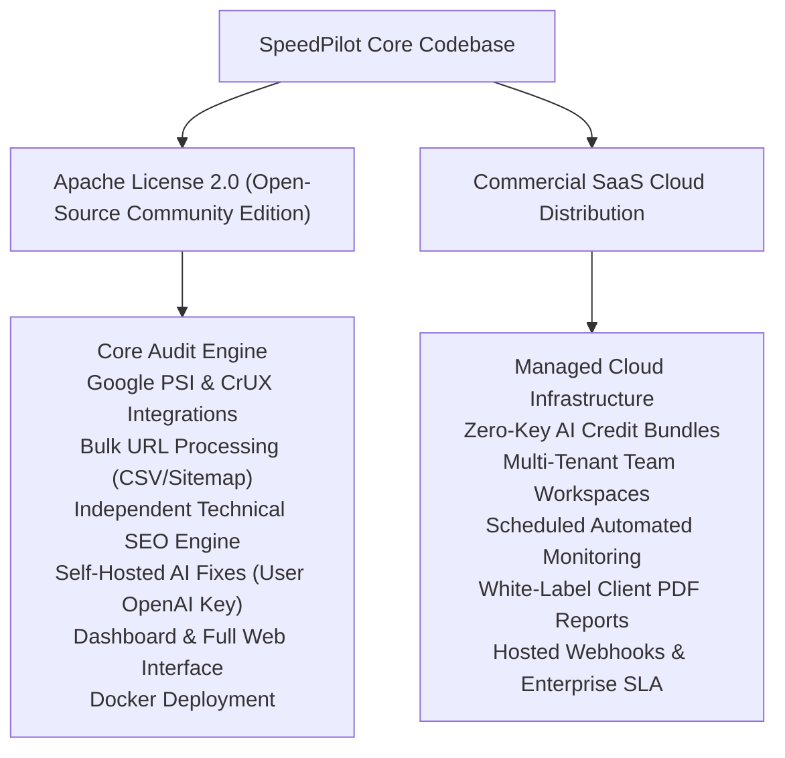

# SpeedPilot — Licensing Architecture & Open-Source Strategy

**Document Version:** 1.0.0  

---

## 1. Dual-Distribution Model

SpeedPilot is governed by a transparent open-core and commercial SaaS model:

---

## 2. Open-Source Edition (Apache License 2.0)

### 2.1 Scope & Guarantees
The open-source core includes:
- **No Crippled Capabilities:** Auditing, bulk processing, performance diagnostics, technical SEO crawls, and AI fixes are 100% functional out of the box.
- **Self-Hosting Freedom:** Can be deployed anywhere via Docker Compose, Kubernetes, or bare metal without commercial phone-home checks or artificial limits.
- **Developer Extensibility:** Clean package APIs for creating custom export plugins, framework detectors, or alternative LLM connectors.

### 2.2 License Grant
Distributed under the **Apache License, Version 2.0**. You may freely use, modify, and distribute this software for personal or commercial projects subject to the terms of the license.

---

## 3. Commercial SaaS Capabilities

Commercial offerings provide convenience and managed infrastructure for agencies and enterprise teams:
- Multi-seat organization management with granular RBAC permissions.
- White-label report branding (upload agency logo, custom color palette, remove SpeedPilot marks).
- Managed high-concurrency cloud worker pool eliminating Google API quota hurdles.
- Subscription billing integration (Stripe and localized payment gateways).
